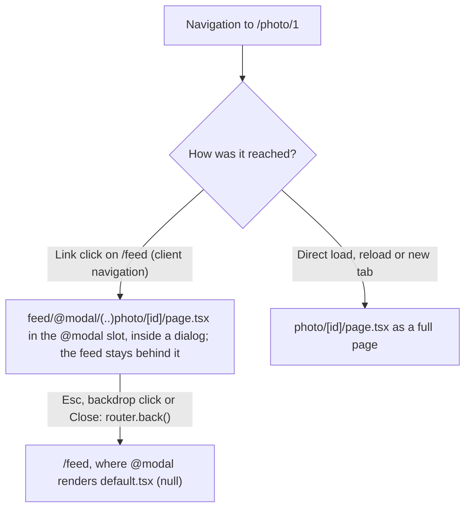

# Intercepting routes

An intercepting route renders another route inside the current layout during client navigation. The URL still changes to the intercepted route, so it can be shared, and a reload shows that route's own page.

**In this repo:** open `/feed` and click a photo. `/photo/1` opens as a modal over the feed; reload, and the full page from `app/photo/[id]` renders instead.

## Markers

The marker in front of the folder name says where the intercepted route lives, counted in route segments:

| Marker     | Intercepts a route  |
| ---------- | ------------------- |
| `(.)`      | on the same level   |
| `(..)`     | one level up        |
| `(..)(..)` | two levels up       |
| `(...)`    | from the `app` root |

Slots are not route segments. In `app/feed/@modal/(..)photo`, the `@modal` folder doesn't count, so `photo` is one level above `feed`, and `(..)` is the right marker.

## Structure

```
app/
├─ feed/
│  ├─ layout.tsx                 ← renders {children} and {modal}
│  ├─ page.tsx                   → /feed
│  ├─ _components/
│  │  └─ modal.tsx               → client <dialog> wrapper
│  └─ @modal/
│     ├─ default.tsx             → null while no modal is open
│     └─ (..)photo/
│        └─ [id]/
│           └─ page.tsx          → /photo/1 as a modal (client navigation)
└─ photo/
   └─ [id]/
      └─ page.tsx                → /photo/1 as a full page (direct load, reload)
```

## Flow



## The modal

`app/feed/_components/modal.tsx` wraps the intercepted page in a native `<dialog>`. `showModal()` provides focus handling, Esc support and an inert page behind it. Every way of closing calls `router.back()`:

```tsx
<dialog
  ref={dialogRef}
  onCancel={(event) => {
    event.preventDefault();
    router.back();
  }}
  onClick={(event) => {
    if (event.target === event.currentTarget) router.back();
  }}
>
```

Esc is handled through the `cancel` event, which fires only when the user asks to close the dialog, so `router.back()` runs exactly once per close.

## Good to know

- **A canonical page is required.** As of Next.js 16.4 the build fails if an interception route has no matching regular page: `app/photo/[id]/page.tsx` is what a reload or a shared link renders.
- **The slot needs a `default.tsx`.** `@modal/default.tsx` returns `null`, so `/feed` renders without a modal on a full page load.
- **Closing with a `<Link>` instead of `router.back()`:** an unmatched slot keeps its last active page on client navigation, so the modal would stay open. Add `@modal/page.tsx` returning `null` for the URL you link to, or `@modal/[...catchAll]/page.tsx` for deeper paths.

Reference: [Intercepting Routes](https://nextjs.org/docs/app/api-reference/file-conventions/intercepting-routes), [Parallel Routes: modals](https://nextjs.org/docs/app/api-reference/file-conventions/parallel-routes#modals)
