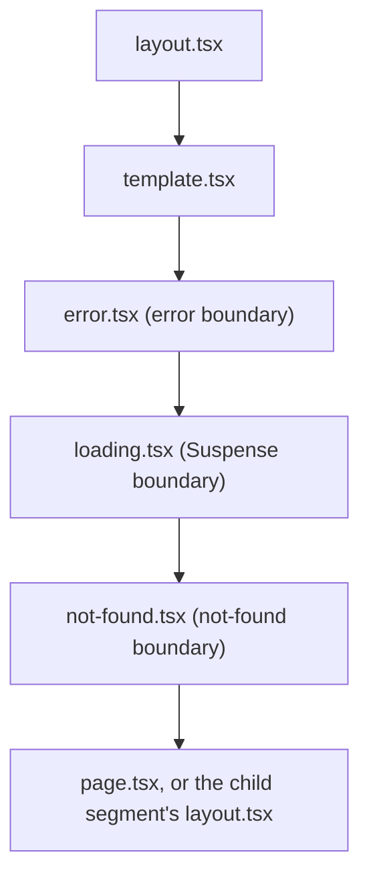

# Layouts and templates

A `layout.tsx` wraps its segment and every route below it. On navigation between those routes, the layout stays mounted: its state is kept and it does not re-render.

**In this repo:** `app/layout.tsx` (root layout, title template, `@analytics` slot) and `app/dashboard/layout.tsx` (sidebar slot and breadcrumb for `/dashboard/*`).

## How it works

```
app/
├─ layout.tsx            → wraps every route (required)
├─ template.tsx          → remounts when the first segment changes
└─ dashboard/
   ├─ layout.tsx         → wraps /dashboard and /dashboard/settings
   ├─ page.tsx           → /dashboard
   └─ settings/
      └─ page.tsx        → /dashboard/settings
```

On `/dashboard/settings`, the root layout wraps the dashboard layout, which wraps the settings page.

## Example

The root layout is required and must render `<html>` and `<body>`:

```tsx
// app/layout.tsx
export default function RootLayout({ children, analytics }: LayoutProps<'/'>) {
  return (
    <html lang="en">
      <body>
        {children}
        {analytics}
      </body>
    </html>
  );
}
```

A nested layout only wraps its own subtree:

```tsx
// app/dashboard/layout.tsx
export default function DashboardLayout({
  children,
  sidebar,
}: LayoutProps<'/dashboard'>) {
  return (
    <div className={styles.shell}>
      <div className={styles.sidebar}>{sidebar}</div>
      <div className={styles.content}>{children}</div>
    </div>
  );
}
```

`LayoutProps<'/route'>` is a global type generated from the route tree (Next.js 15.5+). It types `children`, the async `params`, and every parallel slot of that layout.

## Templates

A `template.tsx` wraps the same subtree as a layout, but is remounted instead of kept. It remounts when its own segment, including dynamic params, changes. Navigating within deeper segments does not remount it, and neither do search params. Client Components inside it lose their state and effects run again.

`app/template.tsx` therefore remounts when you move from `/about` to `/dashboard`, but not from `/dashboard` to `/dashboard/settings`.

## Component hierarchy

Within one segment, the special files nest in this order. A child segment's chain takes the place of the page inside its parent's chain.



So `error.tsx` catches errors from the page and from `loading.tsx`, but not from the layout or template of its own segment, which sit above it. Those are handled by the parent segment's `error.tsx`, or by `global-error.tsx` at the root.

## Good to know

- **Don't put authorization checks in a layout.** Layouts don't re-render on navigation, so the check would not run again on every route change. Check close to the data instead.
- **Layouts can't read `searchParams`.** They would go stale, since layouts don't re-render. Use the page's `searchParams` prop or `useSearchParams()` in a Client Component.

Reference: [layout.js](https://nextjs.org/docs/app/api-reference/file-conventions/layout), [template.js](https://nextjs.org/docs/app/api-reference/file-conventions/template), [Component hierarchy](https://nextjs.org/docs/app/getting-started/project-structure#component-hierarchy)
