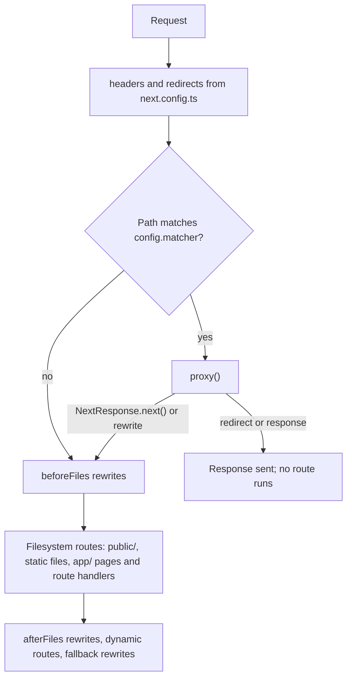

# Proxy

`proxy.ts` runs on the server before a request reaches a route. It can redirect, rewrite, set headers or respond directly. Next.js 16 renamed Middleware to Proxy.

**In this repo:** `proxy.ts` redirects `/admin` and everything below it to `/`. Open `/admin/settings`.

## Example

```ts
// proxy.ts (project root, next to app/)
import { NextResponse, NextRequest } from 'next/server';

export function proxy(request: NextRequest) {
  if (request.nextUrl.pathname.startsWith('/admin')) {
    return NextResponse.redirect(new URL('/', request.url));
  }
  return NextResponse.next();
}

export const config = {
  matcher: '/admin/:path*',
};
```

Without a `matcher`, Proxy runs for every route, static assets included. Matcher values must be constants, because they are read at build time.

## Where it runs



## Migrating from middleware.ts

|              | Next.js 15                                       | Next.js 16                                               |
| ------------ | ------------------------------------------------ | -------------------------------------------------------- |
| File         | `middleware.ts`                                  | `proxy.ts` (`middleware.ts` still works, but deprecated) |
| Export       | `middleware`                                     | `proxy`, as a named or default export                    |
| Runtime      | Edge by default; Node.js opt-in (stable in 15.5) | Node.js only; setting `runtime` throws an error          |
| Config flags | `skipMiddlewareUrlNormalize`                     | `skipProxyUrlNormalize`                                  |

The codemod renames the file, the function and the flags:

```bash
npx @next/codemod@canary middleware-to-proxy .
```

Keeping `middleware.ts` only to stay on the Edge runtime is a short-term option: as of Next.js 16.4 the Edge runtime itself is deprecated.

## Good to know

- **Proxy is not an authorization layer.** Use it for redirects, rewrites, headers and optimistic checks, such as sending visitors without a session cookie to a login page. Server Actions are POST requests to the page that uses them, so a matcher change can silently stop covering them. Verify authorization where data is read or changed.
- **Keep it fast.** Proxy runs before every matched request, so slow work such as database queries belongs in the route, not here.

Reference: [proxy.js](https://nextjs.org/docs/app/api-reference/file-conventions/proxy), [Execution order](https://nextjs.org/docs/app/api-reference/file-conventions/proxy#execution-order)
